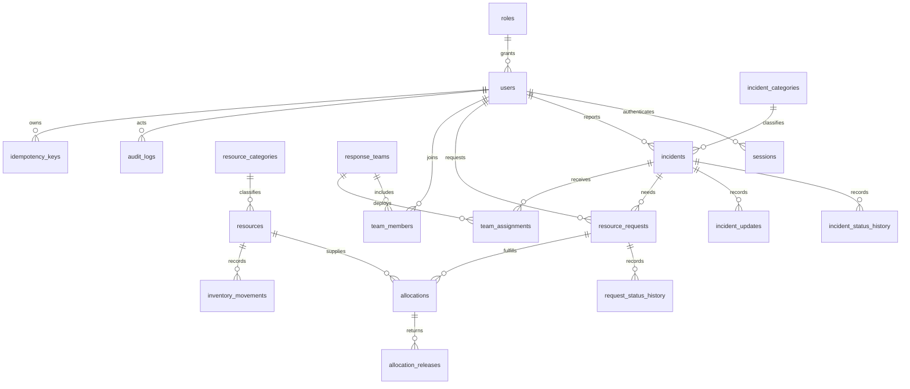

# Proposed PostgreSQL model and transaction rules

Status: initial design retained for context. Migration `backend/migrations/001_initial.sql` has been implemented and applied to local development and disposable test databases. `ARCHITECTURE.md` documents differences: shared reference/history tables, `session`, invitations and fixed permissions. No hosted database was changed. IDs are UUIDs; timestamps use `timestamptz` in UTC. Public codes are labels, never authorization keys. Deactivate reference data instead of removing referenced history.

| Table | Main columns and constraints |
|---|---|
| roles | Fixed unique role key and description; explicit permission mapping in backend code initially |
| users | Case-normalized unique email, display name, password hash, role FK, active flag, must-change-password, session version, timestamps |
| sessions | Session ID/store payload, user FK, expiration; indexed expiry; no credentials in payload |
| incident_categories | Unique name, active flag |
| incidents | Unique code, title, category FK, description, severity, priority, location, reporter FK, reported_at, lifecycle status, version, timestamps |
| incident_status_history | Incident FK, from/to status, reason, actor FK, timestamp |
| incident_updates | Incident FK, author FK, bounded operational text, timestamp |
| resource_categories | Unique name, unit, active flag |
| resources | Unique identifier, name, category FK, description, stock/asset kind, total integer quantity, allocated integer quantity, operational status, location, minimum threshold, version, timestamps |
| resource_requests | Incident FK, requester FK, resource FK or category FK (exactly one), quantity > 0, issued_quantity between 0 and quantity, priority, justification, status, reviewer FK, decision reason/time, timestamps |
| request_status_history | Request FK, previous/next status, actor FK, reason, timestamp |
| allocations | Request FK, resource FK, quantity > 0, released_quantity between 0 and quantity, responsible actor FK, timestamps; incident derived from immutable request link |
| allocation_releases | Allocation FK, positive quantity, actor FK, return condition, reason, timestamp; immutable |
| inventory_movements | Resource FK, optional allocation/release FK, signed stock/allocation delta, reason, actor FK, timestamp |
| response_teams | Unique identifier, name, type, lead user FK, authorized contact, operational status, timestamps |
| team_members | Team/user composite unique FK pair; active membership |
| team_assignments | Team FK, incident FK, status, assigned_by FK, start/end timestamps; partial unique index on team for active statuses |
| audit_logs | Actor FK (nullable for failed login), action, entity type/id, redacted metadata JSONB, request ID, timestamp; runtime role has insert/read only |
| idempotency_keys | Actor FK, action, key, canonical payload digest, recorded response, expiry; unique actor/action/key |
| system_settings | Allowlisted key, validated JSONB value, updated_by FK and timestamp; no arbitrary SQL/config execution |

No granular permission tables are needed while roles are fixed in code. If the proposal requires runtime permission management, add permissions and role_permissions with an explicit grant allowlist, last-admin protection and session invalidation.

## Inventory invariants

`available_quantity = total_quantity - allocated_quantity`. Store one authoritative aggregate and constrain `0 <= allocated_quantity <= total_quantity`, `minimum_threshold >= 0`. Available is computed rather than independently editable. Asset kind additionally constrains total to one. Maintenance/unavailable resources cannot be allocated even if arithmetic availability is positive.

`outstanding_allocation = quantity - released_quantity`. Total active allocation quantity must reconcile with resource allocated quantity. Immutable movements record every adjustment/allocation/return; no silent deletion. The service updates aggregates and ledger in the same transaction. Restrict direct table writes to application-controlled pathways.

## Allocation transaction

1. Authenticate and authorize before starting; validate positive integer quantity and bounded idempotency key.
2. Begin transaction, insert/lock actor/action/key entry. Compare canonical payload digest: replay identical completed calls; reject reuse with different inputs. Concurrent identical requests wait on the unique key.
3. Lock linked incident, request, then selected resource in a consistent order. Check object scope, open incident, approved/partially fulfilled request, resource/category match, operational resource and outstanding demand.
4. Check requested quantity does not exceed `request.quantity - issued_quantity` or actual resource availability. Update with guarded SQL as a second constraint against oversupply.
5. Insert allocation, increment resource allocated quantity and request cumulative issued quantity, derive request fulfillment status, append request history, inventory movement and redacted audit.
6. Persist idempotent response in the same transaction and commit. Roll back all changes on any failure. Retry only bounded transient transaction conflicts, preserving idempotency.

Locking the request prevents two different resources from oversupplying one request. Locking the resource prevents two requests from overallocating the same inventory. Never use pool-level queries inside a transaction that requires a single checked-out client.

## Release transaction

Use its own actor/action/idempotency key. Resolve immutable links, then lock in the same incident/request/resource/allocation order. Validate released quantity against outstanding allocation. Decrease allocated stock, increment released quantity, insert immutable release/movement/audit, and store response atomically. Returned quantity becomes available; damaged returns need an explicitly validated stock/status adjustment in the same transaction. Returns do not reduce cumulative issued demand or reopen a completed request. The proposal must confirm replenishment semantics for consumable resources before modeling them as returnable assets.

## Other concurrency boundaries

- Close/resolve incident and create requests/assignments/allocations all lock incident first, preventing new work racing closure.
- Inventory edits lock resource and reject total below active allocated quantity; use version checks to avoid lost metadata edits.
- Team assignment locks incident then team; the partial unique index prevents concurrent deployment conflicts.
- Role/activation changes serialize using an advisory transaction lock before counting active administrators and updating; increment session version and audit in the transaction.
- Reference deactivation never invalidates historic records; new records require active references.

## Queries, indexes and migrations

Index common foreign keys, incident status/priority/date, resource category/status/location, request status/priority/date and incident, allocation request/resource/date, audit timestamp/actor/action/entity, and session expiry. Bound page size and allowlist sort identifiers. Scope predicates apply before aggregates and pagination. Parameterize values; never interpolate client identifiers.

Shortages combine resource availability with approved unissued demand. Aggregate demand once by requested resource or category; do not multiply category-level demand across each resource. Pending demand is separately labeled unapproved. Inactive resources are excluded from allocatable supply. Threshold alerts use the configured comparison and show the actual quantities.

Migrations are numbered, checksum-tracked, transactionally applied with a migration lock and a separate database role. Do not run schema creation automatically on API startup. Development fixtures must refuse production environments. Verify migration application on a fresh disposable database and upgrade from the prior version. Runtime database credentials must not own the schema or have audit update/delete privileges. Hosted application, backup/restore and concurrency tests remain unverified until a test database is available.
